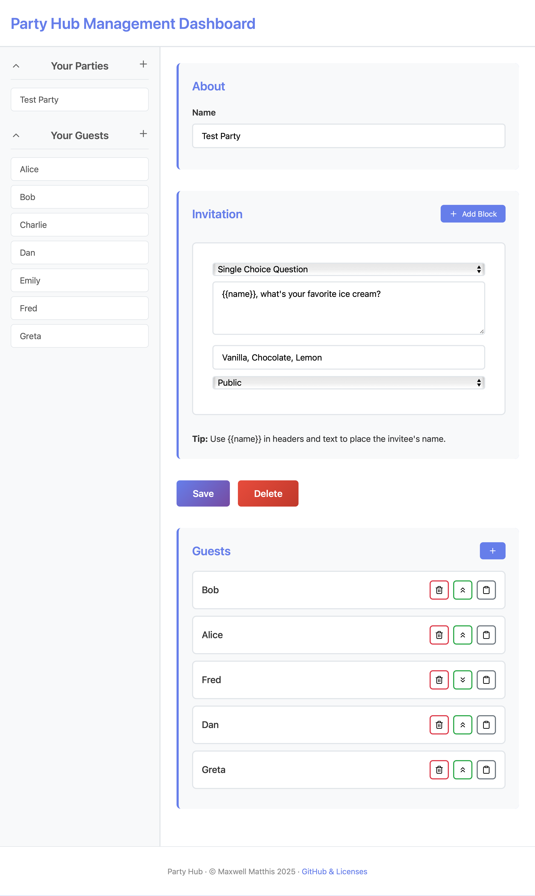
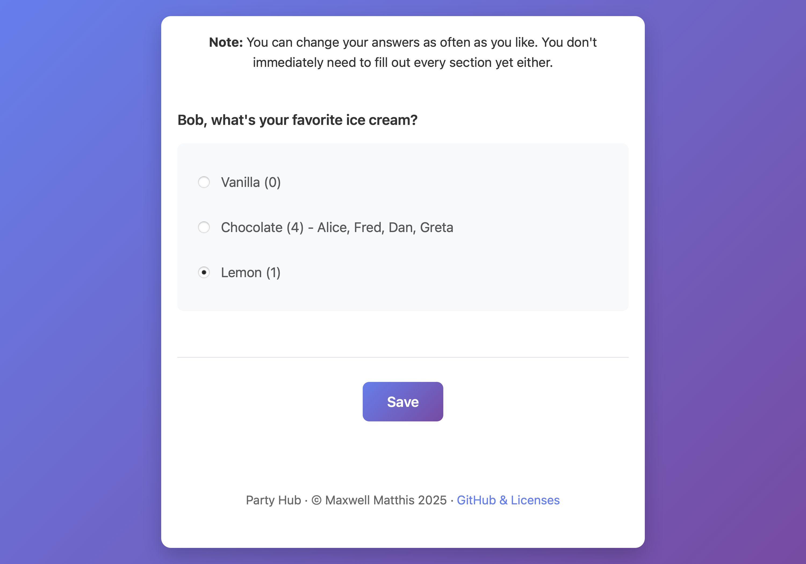

# Party Hub

A modern, minimalistic party invitation platform built with Rust (Actix Web), SQLite, and vanilla JavaScript. Create beautiful party invitations with custom questions, gather responses, and display public statistics in real-time.

## Table of Contents

- [Party Hub](#party-hub)
- [Features](#features)
- [Quick Start](#quick-start)
  - [Prerequisites](#prerequisites)
  - [Installation & Setup](#installation--setup)
- [Production Filesystem Overview](#production-filesystem-overview)
- [Environment Variables](#environment-variables)
  - [Required](#required)
  - [Customization](#customization)
- [VAPID Keys Generation](#vapid-keys-generation)
- [Email Notifications Setup (Optional)](#email-notifications-setup-optional)
  - [Option 1: SMTP Client (Using your email provider)](#option-1-smtp-client-using-your-email-provider)
  - [Option 2: Direct SMTP (Send directly from your server)](#option-2-direct-smtp-send-directly-from-your-server)
- [License](#license)


*Management interface for creating parties and managing guests*


*Guest-facing invitation with real-time statistics*

## Features

- 🎉 **Custom Party Creation**: Create parties with flexible block-based invitation editor
- 📝 **Multiple Question Types**:
  - **Text Input**: Free-form text responses
  - **Number Input**: Numeric responses
  - **Single Choice**: Radio button selections with live vote counts
  - **Multiple Choice**: Checkbox selections with live vote counts
  - **Attendance Block**: Dedicated RSVP functionality with customizable options
- 👥 **Guest Management**: Easy guest creation, invitation system, and organizer privileges
- 🔗 **Public Party Links**: Share a single link that allows anyone to self-register and create their own invitation
  - Copy public party link with one click
  - Self-registered guests are marked with a badge
  - Optional guest limit enforcement
- 📊 **Real-time Statistics**: Public questions show live vote counts and guest names as responses come in
- 🔒 **Privacy Controls**: Questions can be marked as public (visible to all) or private (organizer-only)
- 📱 **Responsive Design**: Modern, clean UI that works on all devices
- ⚡ **Live Updates**: Vote counts update instantly when you make selections
- 🌐 **Localization**:
  - Automatic language detection based on browser preferences
  - Full German and English support
  - Informal German ("du") for friendly communication
- 👤 **Guest Personalization**: Use template variables in your content:
  - `{{salutation}}` - Guest's salutation (e.g., Mr., Ms., Dr.)
  - `{{first}}` - Guest's first name
  - `{{last}}` - Guest's last name
  - `{{name}}` - Full name (first + last) for backward compatibility
- 🔐 **Secure Authentication**: Token-based authentication for party organizers

## Quick Start

### Prerequisites

- Rust/Cargo (latest stable version)
- SQLite3
- NPX

### Installation & Setup

1. **Clone**:

   Clone this repository to your home or git project directory.

   ```bash
   git clone https://github.com/maxwellmatthis/party-hub.git
   cd party-hub
   ```

2. **Compile and install**:

    **Production**

    If you are installing on a server for production use and are okay with a systemd/reverse proxy
    setup, you can simply run the `install.sh` script. Check it out for more information.

    You can safely rerun `install.sh` to perform updates. Just don't forget to `git pull` new
    changes first. Config files and keys won't be touched if they already exist.

    **Development or Testing**

    For development purposes, it is recommended that you edit the development config and export the
    environment variables to your current shell using `set -a; source dev-config.env; set +a`. Then
    you can simply `cargo run` the project for development.

3. **Create your first author account**:

    Please note that this script assumes that SQLITE_DB_PATH is set.

    ```bash
    # run this line if you installed for production using the script.
    export SQLITE_DB_PATH=/var/lib/party-hub/party.db

    ./createAuthor.sh "Your Name"
    ```

    Save the generated secret to log into the management interface.

## Production Filesystem Overview

The installer provisions the following paths for a production deployment:

| Path | Purpose | Permissions |
| --- | --- | --- |
| /etc/systemd/system/party-hub.service | Systemd unit file for the service | 644, root:root |
| /etc/party-hub/ | Directory for shared config and VAPID keys | 755, root:root |
| /etc/party-hub/config.env | Runtime environment configuration | 640, root:party-hub |
| /etc/party-hub/public_vapid_key.pem | Public VAPID key used for web push notifications | 640, root:party-hub |
| /etc/party-hub/private_vapid_key.pem | Private VAPID key used for web push notifications | 640, root:party-hub |
| /var/lib/party-hub/ | Data directory for persistent application state | 750, party-hub:party-hub |
| /var/lib/party-hub/party.db | SQLite database file | 640, party-hub:party-hub |
| /var/www/party-hub/assets/ | Root directory for served web assets | 750, party-hub:party-hub |
| /var/www/party-hub/assets/pages/ | Rendered HTML pages served by the app | 750, party-hub:party-hub |
| /var/www/party-hub/assets/static/ | CSS, JavaScript, images, and other static files | 750, party-hub:party-hub |
| /usr/local/bin/party-hub | Installed application binary | 755, root:root |

## Environment Variables

Party Hub supports the following environment variables for configuration:

### Required

- **`PUBLIC_VAPID_KEY_PATH`**: Path to public web-push key.
- **`PRIVATE_VAPID_KEY_PATH`**: Path to private web-push key.
- **`SQLITE_DB_PATH`**: Path to sqlite database.
- **`WEB_ASSETS_PATH`**: Path to static assets to be served to the web.

### Customization

- **`PORT`**: Set the server port (default: 8080)
- **`ENV`**: Set the environment mode (default: "prod")
  - `ENV=dev`: Enables development mode with insecure cookies for localhost testing
  - `ENV=prod`: Production mode with secure cookies (default)
- **`MAIL_SENDTYPE`**: Choose email sending method (optional)
  - `MAIL_SENDTYPE=client`: Use SMTP client (send through mail provider)
  - `MAIL_SENDTYPE=direct`: Use direct SMTP (send directly to recipient's server)
  - If not set: Automatically detects and uses available method (client preferred)
  - => **Also see [Email Notification Setup](#email-notifications-setup-optional) below for more options.

## VAPID Keys Generation

VAPID Keys are used to authenticate when sending push notifications.

```bash
# Generate VAPID keys
npx --yes web-push generate-vapid-keys

# paste the resulting keys into these files for development or before moving to production secret directory
vim public_vapid_key.pem
vim private_vapid_key.pem
```

## Email Notifications Setup (Optional)

Party Hub supports two methods for sending email notifications to guests. If none is configured, emails will silently fail to be sent without further consequences. Push notifications are not influenced by email setup.

### Option 1: SMTP Client (Using your email provider)

This method sends emails through your email provider's SMTP server (Gmail, Outlook, etc.). This is the easiest option.

1. **Set environment variables**:

    ```bash
    export SMTP_SERVER="smtp.gmail.com"              # Your SMTP server
    export SMTP_USERNAME="your-email@gmail.com"      # Your email address
    export SMTP_PASSWORD="your-app-password"         # Your email password or app password
    export SMTP_FROM="Party Hub <noreply@yourdomain.com>"  # From address
    export BASE_URL="https://your-domain.com"        # Base URL for invitation links
    ```

2. **Common SMTP providers**:

    - **Gmail**:
      - Server: `smtp.gmail.com`
      - Port: 587 (automatic)
      - Requires an [App Password](https://support.google.com/accounts/answer/185833)

    - **Outlook/Office 365**:
      - Server: `smtp.office365.com`
      - Port: 587 (automatic)

    - **Custom/Self-hosted**:
      - Use your mail server's SMTP details

### Option 2: Direct SMTP (Send directly from your server)

This method sends emails directly to recipients' mail servers without using a mail server. This means **you don't need to store your email credentials on the server**, but it requires proper DNS configuration to avoid spam filters.

__Warning:__ Adding a second SPF record on top of already existing email infrastructure will
likely break your mail server. Only chose this option if you have extensive control of your
mail server or you do not run a mail server for your chosen domain but would like to send emails.

1. **Set only the required environment variables**:

    ```bash
    export SMTP_FROM="Party Hub <noreply@yourdomain.com>"  # Must match your domain
    export BASE_URL="https://your-domain.com"        # Base URL for invitation links
    ```

    **Note**: To force direct SMTP mode even when client credentials are available, set `MAIL_SENDTYPE=direct`. Otherwise, if SMTP client credentials are not configured, Party Hub will automatically use direct SMTP sending.

2. **DNS Configuration for Direct SMTP**:

    To ensure your emails aren't marked as spam, you must configure these DNS records for your domain:

    **SPF Record** (Sender Policy Framework):

    ```txt
    Type: TXT
    Name: @
    Value: v=spf1 ip4:YOUR_SERVER_IP -all
    ```

    Replace `YOUR_SERVER_IP` with your server's public IP address. This tells email servers that your server is authorized to send email for your domain.

    **DKIM Record** (DomainKeys Identified Mail):
    DKIM signing is more complex and requires generating a private/public key pair. Consider using a service like [EasyDMARC](https://easydmarc.com/tools/dkim-record-generator) to generate your DKIM keys and records.

    **DMARC Record** (Domain-based Message Authentication):

    ```txt
    Type: TXT
    Name: _dmarc
    Value: v=DMARC1; p=quarantine; rua=mailto:postmaster@yourdomain.com
    ```

    This tells receiving servers to quarantine emails that fail SPF/DKIM checks and send reports to your postmaster address.

    **Example complete DNS setup**:

    ```txt
    # SPF - Authorize your server's IP
    @ IN TXT "v=spf1 ip4:203.0.113.10 -all"

    # DMARC - Set policy and reporting
    _dmarc IN TXT "v=DMARC1; p=quarantine; rua=mailto:postmaster@yourdomain.com"

    # DKIM - Public key for verification (generated separately)
    default._domainkey IN TXT "v=DKIM1; k=rsa; p=YOUR_PUBLIC_KEY_HERE"
    ```

    **Important Notes**:
    - DNS changes can take hours or days to propagate
    - Test your configuration with [mail-tester.com](https://www.mail-tester.com/)
    - Without proper SPF/DKIM/DMARC, your emails will likely end up in spam
    - Major email providers (Gmail, Outlook) require DKIM for good deliverability
    - Consider using Option 1 (SMTP Client) if DNS configuration is too complex

## License

This project is licensed under the **GNU Affero General Public License v3.0** (AGPLv3). See the LICENSE file for details.
